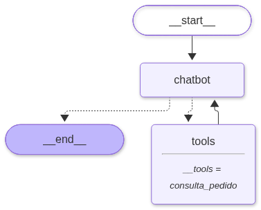

# langgraph-basics

Práctica guiada de LangGraph. Se empieza con un grafo de dos nodos y se termina con un **agente con herramientas y memoria** que usa un LLM local (Ollama + `llama3.1`).



## Entregable

- **Repositorio:** esta carpeta.
- **Diagrama del grafo:** [`grafo_completo.png`](grafo_completo.png), arriba. Lo genera `visualizar_grafo.py`. Las flechas punteadas que salen de `chatbot` son la arista condicional y la flecha `tools → chatbot` es el ciclo.
- **2 ejecuciones, una por rama:** [`ejecuciones/ejecuciones_por_rama.txt`](ejecuciones/ejecuciones_por_rama.txt), generado con `.venv/bin/python comparar_caminos.py`.
  - **Rama sin tool:** "¿Cuál es la capital de Francia?" → `START → chatbot → END`.
  - **Rama con tool:** "¿En qué estado está el pedido 5678?" → `START → chatbot → tools → chatbot → END`.

## Puesta en marcha

Requisitos: Python 3.10 o superior y [Ollama](https://ollama.com) en marcha con el modelo `llama3.1` (`ollama pull llama3.1`).

```bash
python3 -m venv .venv
.venv/bin/pip install -r requirements.txt
```

Todos los scripts se ejecutan desde esta carpeta con `.venv/bin/python <script>.py`.

## Los conceptos

**State**: el diccionario tipado (`TypedDict`) que recorre el grafo. Es la memoria de trabajo que comparten todos los nodos. Cada campo puede llevar un **reducer** que dice cómo se combinan los cambios. Por ejemplo, con `messages: Annotated[list, add_messages]` los mensajes nuevos se *añaden* en vez de sustituir la lista.

**Nodos**: funciones de Python que reciben el state y devuelven un dict **solo con los campos que cambian**. Un nodo puede ser lógica normal, una llamada al LLM o un `ToolNode` que ejecuta herramientas.

**Aristas**: deciden qué se ejecuta después.
- `add_edge(a, b)`: arista fija. Al terminar `a`, siempre se ejecuta `b`.
- `add_conditional_edges(a, funcion)`: una función mira el state y devuelve el nombre del siguiente nodo. Es el `if` del grafo y permite ciclos como `chatbot → tools → chatbot`.
- `START` y `END` son la entrada y la salida.

**Checkpointer**: al compilar con `builder.compile(checkpointer=MemorySaver())`, LangGraph guarda una foto del state antes y después de cada nodo, separada por `thread_id` (`config = {"configurable": {"thread_id": "..."}}`). Así se consigue:
- memoria entre turnos de una conversación;
- conversaciones aisladas, cada una con su `thread_id`;
- historial inspeccionable (`get_state_history`) y reanudación si algo falla.

`MemorySaver` guarda en RAM. Para persistir los datos se usa `SqliteSaver` o `PostgresSaver` con el mismo código.

## Recorrido (en orden)

| Paso | Script | Qué muestra |
|---|---|---|
| 1 | `grafo_basico.py` | State con un campo y dos nodos: `'hola langgraph'` → `'HOLA LANGGRAPH!!!'`. Genera `grafo.png`. |
| 2 | `stream_updates.py` | `stream(stream_mode="updates")`: qué devuelve cada nodo, paso a paso. |
| 3 | `chatbot.py` | State de mensajes + nodo con `ChatOllama`. El modelo se inventa qué es LangGraph. |
| 4 | `reducer_comparacion.py` | El mismo grafo con y sin `add_messages`: 3 mensajes frente a 1. |
| 5 | `chatbot_memoria.py` | `MemorySaver` + `thread_id`: recuerda el nombre; otro thread no lo sabe. |
| 6 | `historial_checkpoints.py` | `get_state_history`: 2 turnos = 6 checkpoints. |
| 7 | `agente_tools.py` | `@tool` + `ToolNode` + arista condicional + memoria: el turno 2 consulta el pedido sin decir su número. |
| 8 | `comparar_caminos.py` | El mismo grafo toma caminos distintos: `chatbot → END` frente a `chatbot → tools → chatbot → END`. |
| 9 | `visualizar_grafo.py` | Dibuja el grafo final en `grafo_completo.png`. |

Los pasos 1, 2, 4 y 9 no usan el LLM. Los demás necesitan Ollama.

## Extras (variaciones vistas en clase)

Se ejecutan también desde esta carpeta: `.venv/bin/python extras/<script>.py`. Cada script es independiente.

| Script | Qué muestra |
|---|---|
| `extras/paso1_stream.py` | `stream_mode="values"` frente a `"updates"`: el State completo tras cada nodo frente a solo lo que cambia. Sin LLM. |
| `extras/paso2_sin_reducer.py` | Chatbot con memoria sin `add_messages`: el checkpointer guarda, pero cada turno pisa el historial y el bot olvida el nombre. |
| `extras/paso3_checkpoints.py` | El contenido de cada foto del checkpointer y cómo reanudar desde una foto intermedia. Sin LLM. |
| `extras/paso4_sin_tool.py` | La arista condicional ya hecha (`tools_condition`) decide con y sin tool, e imprime su decisión en cada paso. |

## Ejercicios para casa

**Ejercicio 1 · Un grafo que clasifica y responde.** Clasifica un mensaje como *pregunta* o *queja*. Una arista condicional lo manda a un nodo de respuesta u otro, cada uno con un tono distinto.
Solución de referencia: `soluciones/ejercicio1_clasificador.py` (inténtalo antes de mirarla).

**Ejercicio 2 · Reto: el grafo por fases.** Construye tu propio agente paso a paso:
1. Un grafo simple con un State propio y dos nodos.
2. Conviértelo en chatbot (`add_messages` + `ChatOllama`).
3. Dale memoria (checkpointer + `thread_id`).
4. Añade **tu propia tool** (por ejemplo, el tiempo de una ciudad, el stock de un producto o un conversor de unidades) con `ToolNode` y una arista condicional.

Termina con una conversación de varios turnos en la que la tool se use al menos una vez, y en la que algún turno dependa de lo dicho antes.

## Notas

- `draw_mermaid_png()` usa el servicio web mermaid.ink, así que necesita conexión a internet.
- `llama3.1` es un modelo pequeño. Con tools enlazadas decide bien *si* usar la tool, pero cuando no la usa suele contestar mal ("no tengo una función para eso"). Por eso, en `agente_tools.py`, el nodo `chatbot` usa `temperature=0` y un `SystemMessage`, y si el modelo no pide ninguna tool repite la llamada **sin** tools enlazadas. El camino del grafo no cambia. Con modelos más grandes no hace falta este truco.
